# CropRisk Atlas: Weather & Field-Based Crop Disease Risk Mapping Intelligence

> **Academic Project:** Final Year Engineering & Agricultural Technology Project  
> **Geographical Scope:** Madurai District (11 Administrative Taluks), Tamil Nadu, India  
> **Crop Scope:** Rice / Paddy (*Oryza sativa*)  
> **Initial Pathogens:** Rice Blast (*Magnaporthe oryzae*), Brown Spot (*Bipolaris oryzae*)  
> **Core Objective:** Field Surveillance Prioritization & Geospatial Risk Early-Warning Engine  

---

## 1. Project Overview & Surveillance Philosophy

**CropRisk Atlas** is a geospatial agriculture intelligence web platform engineered to assist agricultural extension officers, plant protection squads, and researchers in prioritizing field inspection rounds.

### Key Distinction: Surveillance Prioritization vs. Computer Vision Diagnosis
Most agricultural applications attempt to classify crop diseases from smartphone photographs of already-symptomatic leaves. While valuable, image classification is a **reactive** intervention that occurs *after* fungal pathogens have established extensive mycelial infection and sporulation.

In contrast, **CropRisk Atlas is a proactive spatial early-warning system**:
1. Analyzes rolling microclimatic windows (minimum night temperatures, morning relative humidity, precipitation, leaf wetness duration).
2. Computes epidemiological infection indices based on published biological rules from the **Tamil Nadu Agricultural University (TNAU)** and **International Rice Research Institute (IRRI)**.
3. Automatically maps GPS field scouting logs to their enclosing administrative taluk using **Point-in-Polygon (PIP)** spatial indexing.
4. Identifies high-vulnerability geographical clusters to direct scarce agricultural manpower and prophylactic advisories **before** catastrophic outbreaks develop.

---

## 2. System Architecture

```mermaid
flowchart TD
    subgraph FRONTEND ["Presentation Tier (React 18 + Vite + Bootstrap 5 + Leaflet)"]
        DASH["Executive Dashboard\n(Surveillance Gauges, Alerts, Recent Scouts)"]
        MAP["Interactive GeoMap\n(Leaflet Choropleth + Clustered Field Pins)"]
        INGEST["Data Ingestion Hub\n(Weather & Observation CSV Drag-and-Drop)"]
        SCOUT["Field Scouting Form\n(Live GPS Point Validation + IRRI SES Slider)"]
        REP["Area Reports & Export\n(Plotly Trends, CSV Stream & jsPDF Dossier)"]
    end

    subgraph API ["REST Gateway Tier (FastAPI + Uvicorn)"]
        SPATIAL_API["/api/v1/spatial/*\n(Madurai GeoJSON, PIP Validation)"]
        DATA_API["/api/v1/data/*\n(CSV Validation, Batch Audit, Scout Logs)"]
        WEATHER_API["/api/v1/weather/*\n(Meteorological Time-Series)"]
        RISK_API["/api/v1/risk/*\n(Rule Engine, ML Training, Map Layers)"]
        REPORT_API["/api/v1/reports/*\n(Taluk Summaries, CSV Streams)"]
    end

    subgraph CORE ["Domain & Computational Engines Tier"]
        GEO_ENG["Geospatial Engine (geospatial.py)\n(Shapely STRtree PIP, WGS84/UTM 44N, IDW Interpolation)"]
        EPI_ENG["Epidemiological Engine (risk_engine.py)\nTNAU/IRRI Mathematical Conducive Rules & 5-Day Decay"]
        ML_ENG["Machine Learning Engine (ml_engine.py)\nFeature Engineering, Spatial GroupKFold CV, Random Forest"]
        VAL_ENG["Data Ingestion Service (ingestion.py)\nRow-level Parsing, Range Checks, Provenance Attribution"]
    end

    subgraph STORAGE ["Storage & Persistence Tier"]
        DB[(SQLite / SQLAlchemy ORM)]
        GEOJSON_STORE["Madurai 11 Taluks GeoJSON\n(Centroids, MultiPolygons, Hectares)"]
        MODEL_STORE["Joblib Model Registry\n(blast_rf_model.joblib)"]
    end

    FRONTEND <-->|REST API / JSON & GeoJSON| API
    API --> CORE
    CORE <--> STORAGE
```



---

## 3. Scientific Methodology & Epidemiological Rules

### 3.1 Rice Blast (*Magnaporthe oryzae* / *Pyricularia oryzae*)
Rice blast is heavily driven by sporulation, germination, and appressorium formation requiring a surface moisture film and cool-to-moderate night temperatures.

* **Optimal Night Temperature ($T_{min}$):** $20.0^\circ\text{C} - 24.0^\circ\text{C}$ (permissible: $18.0^\circ\text{C} - 26.0^\circ\text{C}$).
* **Relative Humidity ($RH_{morning}$ / $RH_{avg}$):** $\ge 90\%$.
* **Leaf Wetness Duration ($LWD$):** $\ge 10 - 12\text{ hours}$.
* **Vulnerable Growth Stages ($C_s$):** Active Tillering (Leaf Blast) and Heading/Flowering (Neck/Panicle Blast).

$$\text{DBII}_t = f_T(T_{min, t}) \times f_H(RH_{avg, t}) \times f_W(LWD_t) \times C_s$$

Where:
$$f_T(T) = \begin{cases}
1.0, & 20.0 \le T \le 24.0^\circ\text{C} \\
0.7, & 18.0 \le T < 20.0^\circ\text{C} \text{ or } 24.0 < T \le 26.0^\circ\text{C} \\
0.2, & 16.0 \le T < 18.0^\circ\text{C} \text{ or } 26.0 < T \le 28.0^\circ\text{C} \\
0.0, & \text{otherwise}
\end{cases}$$

$$f_H(RH) = \begin{cases}
1.0, & RH \ge 90\% \\
0.6, & 85\% \le RH < 90\% \\
0.2, & 80\% \le RH < 85\% \\
0.0, & \text{otherwise}
\end{cases}$$

The **Cumulative 5-Day Blast Risk Score ($R_{blast}$)** is computed with temporal decay weights:
$$R_{blast} = \min\left(1.0, \; \frac{1}{\sum_{k=0}^4 w_k} \sum_{k=0}^4 w_k \cdot \text{DBII}_{t-k}\right) \quad \text{where } w = [0.35, 0.25, 0.20, 0.10, 0.10]$$

---

### 3.2 Brown Spot (*Bipolaris oryzae* / *Cochliobolus miyabeanus*)
* **Optimal Temperature ($T_{avg}$):** $26.0^\circ\text{C} - 30.0^\circ\text{C}$ (mean $\sim 28.0^\circ\text{C}$).
* **Relative Humidity ($RH_{avg}$):** $\ge 85\%$ sustained.
* **Leaf Wetness Duration ($LWD$):** $\ge 8\text{ hours}$.
* **Vulnerable Stages:** Maximum Tillering through Milk/Dough stage.

$$\text{DBSII}_t = g_T(T_{avg, t}) \times g_H(RH_{avg, t}) \times g_W(LWD_t) \times C_s$$

---

### 3.3 Surveillance Priority Classification

| Risk Score Range | Priority Level | Color Code | Action Directive for Agricultural Teams |
| :---: | :---: | :---: | :--- |
| **$0.00 \le R < 0.35$** | **LOW** | Green (`#28a745`) | Microclimate unfavorable. Routine periodic monitoring. |
| **$0.35 \le R < 0.70$** | **MEDIUM** | Amber (`#ffc107`) | Moderately conducive. Increase scouting rounds; inspect susceptible varieties. |
| **$0.70 \le R \le 1.00$** | **HIGH** | Crimson (`#dc3545`) | Highly conducive environment. Immediate field dispatch; verify prophylactic fungicide availability. |

---

## 4. Machine Learning & Spatial Cross-Validation

### Elimination of Spatial Autocorrelation Leakage
In agricultural epidemiology, proximate farms share identical weather patterns. Random train-test splits cause test data points adjacent to training data to yield artificially inflated test scores.

To prevent geographic data leakage, **CropRisk Atlas** implements **Spatial Block Cross-Validation (`GroupKFold`) partitioned by Taluk**:
* The model is strictly evaluated on taluks held out during training.
* Performance is reported via **Precision-Recall AUC (PR-AUC)**, **Balanced F1-Score**, and **Brier Calibration Score**, rejecting naive accuracy metrics on imbalanced disease data.

---

## 5. Technology Stack & Directory Layout

### Backend
* **Language & Runtime:** Python 3.12+
* **Framework:** FastAPI, Uvicorn, Pydantic v2
* **Database & ORM:** SQLite, SQLAlchemy 2.0
* **Geospatial & Mathematics:** GeoPandas, Shapely 2.0, PyProj, SciPy, NumPy, Pandas
* **Machine Learning:** Scikit-learn, Joblib
* **Testing:** Pytest

### Frontend
* **Runtime & Bundler:** React 18, Vite
* **UI & Styling:** Bootstrap 5, Bootstrap Icons
* **Mapping & GIS:** Leaflet 1.9, React-Leaflet
* **Visualizations:** Plotly.js, React-Plotly
* **Export Utilities:** jsPDF, jsPDF-AutoTable, Axios

### Folder Structure
```
CropRisk-Atlas/
├── backend/
│   ├── app/
│   │   ├── main.py                  # FastAPI factory & lifespan setup
│   │   ├── core/config.py           # Configuration & bounding box
│   │   ├── db/                      # SQLAlchemy session & seed script
│   │   ├── models/                  # Database ORM models
│   │   ├── schemas/                 # Pydantic validation schemas
│   │   ├── services/
│   │   │   ├── geospatial.py        # PIP indexing, IDW interpolation, GeoJSON
│   │   │   ├── ingestion.py         # CSV parsing, sanity checks, error logs
│   │   │   ├── risk_engine.py       # TNAU/IRRI mathematical rules
│   │   │   └── ml_engine.py         # Rolling features, GroupKFold, Random Forest
│   │   └── api/v1/                  # REST endpoints (spatial, data, risk, reports)
│   ├── static/
│   │   ├── geojson/                 # madurai_taluks.geojson
│   │   └── models/                  # Persisted joblib model registry
│   ├── tests/                       # 30 automated Pytest suites
│   ├── requirements.txt
│   └── run.py                       # Server entrypoint
│
├── frontend/
│   ├── src/
│   │   ├── api/apiClient.js         # Axios HTTP services
│   │   ├── components/Navbar.jsx    # Navigation header
│   │   ├── pages/
│   │   │   ├── DashboardPage.jsx    # KPIs, gauges, recent scout feed
│   │   │   ├── MapPage.jsx          # Leaflet choropleth & cluster pins
│   │   │   ├── DataManagerPage.jsx  # CSV upload hub with audit trail
│   │   │   ├── ScoutingPage.jsx     # Live GPS PIP validator & SES form
│   │   │   ├── ReportsPage.jsx      # Plotly trends, CSV & PDF export
│   │   │   └── KnowledgeBasePage.jsx# Biological guidelines & SES reference
│   │   ├── App.jsx
│   │   ├── main.jsx
│   │   └── index.css
│   ├── package.json
│   └── vite.config.js
│
├── data/
│   └── templates/                   # User-ready standard CSV templates
│       ├── weather_data_template.csv
│       └── field_observations_template.csv
│
└── README.md
```

---

## 6. Installation & Execution Guide

### 6.1 Backend Setup
```bash
# Navigate to backend directory
cd backend

# Create and activate Python virtual environment
python -m venv venv
# Windows:
.\venv\Scripts\activate
# Linux/Mac:
source venv/bin/activate

# Install dependencies
pip install -r requirements.txt

# Initialize database and seed Madurai reference data
python -m app.db.seed_data

# Run the automated test suite (30 tests)
pytest -v

# Launch the FastAPI backend server (Port 8000)
python run.py
```
Backend API interactive documentation is available at: `http://localhost:8000/docs`

---

### 6.2 Frontend Setup
```bash
# In a new terminal, navigate to frontend directory
cd frontend

# Install Node dependencies
npm install

# Build production bundle
npm run build

# Start local development server (Port 3000)
npm run dev
```
Open `http://localhost:3000` in your web browser.

---

## 7. Verification & Test Suite Summary

The application includes 30 comprehensive automated tests covering all subsystems:

| Test File | Tests Passed | Subsystem Covered |
| :--- | :---: | :--- |
| `tests/test_database.py` | 3 | Table schema constraints, unique provenance indexes, reference data seeding |
| `tests/test_geospatial.py` | 5 | Madurai bounding box filtering, Shapely STRtree Point-in-Polygon, IDW precision, GeoJSON styling |
| `tests/test_ingestion.py` | 4 | CSV header parsing, numeric range validation, out-of-district GPS rejection, row error logging |
| `tests/test_risk_engine.py` | 7 | Rice blast & brown spot ideal vs. suppressive weather, 5-day decay weighting, database persistence |
| `tests/test_ml_engine.py` | 3 | 11-feature environmental extraction, Spatial GroupKFold CV without leakage, probability calibration |
| `tests/test_api.py` | 7 | REST endpoints: health check, GeoJSON, GPS validation, observations, risk calculation, CSV export |
| `tests/test_end_to_end.py` | 1 | Complete workflow: CSV upload $\to$ PIP mapping $\to$ ML training $\to$ choropleth $\to$ PDF/CSV export |
| **Total** | **30 / 30** | **100% Pass Rate (0 Failures, 0 Warnings)** |

---

## 8. Academic References & Citations

1. **Tamil Nadu Agricultural University (TNAU):** *Crop Protection Guidelines – Management of Rice Diseases (Blast and Brown Spot)*. Agritech Portal, Coimbatore, Tamil Nadu, India.
2. **International Rice Research Institute (IRRI):** *Standard Evaluation System for Rice (SES)*, 5th Edition. Los Baños, Laguna, Philippines.
3. **Katsantonis, D., Kadoglidou, K., Antonopoulos, N. et al. (2017):** *Evaluation of rice blast forecasting models under Mediterranean conditions*. Crop Protection, Elsevier.
4. **All India Coordinated Research Project on Rice (AICRP-Rice):** *Annual Disease Surveillance and Progress Report*, ICAR-Indian Institute of Rice Research (ICAR-IIRR), Rajendranagar, Hyderabad, India.
